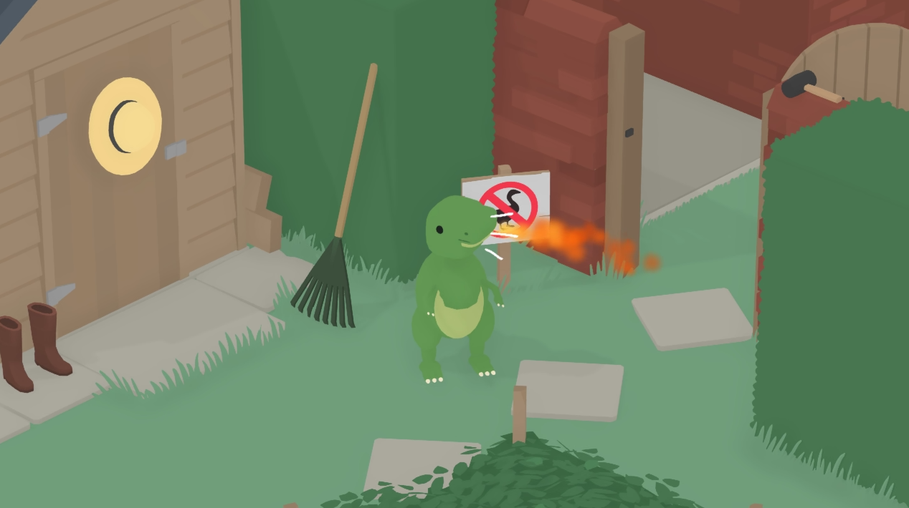

# Chompy Playtime

**A tiny T-Rex. A very troublesome village.**

By **DefaultAvatarGuy** · First public release **v1.0.0**

Created by DefaultAvatarGuy with the help of AI (GPT-6.1 Sol).

Chompy replaces the goose with a little green cartoon T-Rex designed to fit Untitled Goose Game's simple visual style and existing animations. Roar at the villagers, flail tiny arms, change size, breathe fire, and unleash a dusty fart with simple controls.

*Gameplay screenshot supplied by DefaultAvatarGuy.*

## Features

- Chompy's original green T-Rex design, with a pale belly and long tail.
- Visible tiny arms that flail using the game's usual wing-flap action.
- Recorded dinosaur roar in place of honking; original honk can be restored.
- Three sizes: normal, big, and tiny.
- Cosmetic fire that follows the direction of Chompy's head.
- A dedicated fart button, with brown dust, a sound, and honk-style sound lines.
- Keyboard shortcuts and Xbox/XInput controller combinations.
- One combined install, no character-selection screen, and no save-file edits.

## Compatibility and download

Tested by the author on **Windows x64 / itch.io DRM-free / Untitled Goose Game 1.1.4**. Other versions and storefronts are unverified; exact file checks may refuse them. Both goose rigs are supported in code; local co-op shares the fun settings. Broader co-op compatibility testing is welcome.

Download the **player release ZIP**, extract it, place the complete **Chompy-Playtime** folder beside **Untitled.exe**, and run **Install.cmd** once with the game closed. Launch the game normally afterward. See [INSTALL.md](INSTALL.md) for placement, updating, restoring the honk, and full removal. Manual installation only; mod-manager deployment is not verified.

## Controls

| Action | Keyboard | Xbox / XInput controller |
| --- | --- | --- |
| Roar; breathe fire when enabled | Game's normal honk key | Game's normal honk button |
| Flail tiny arms | Game's normal wing-flap key | Game's normal wing-flap button |
| Cycle normal → big → tiny | F6 | Hold LB + RB, tap Y |
| Toggle fire | F7 | Hold LB + RB, tap X |
| Normal size; fire off | F8 | Hold LB + RB, tap B |
| Fart | F9 | Click right stick (R3); alternatively hold LB + RB, tap A |

LB/RB are the shoulder buttons, not the triggers. Native game actions may also happen while using a combination. Size/fire settings are shared in local co-op; each character's arms follow its own flap. Fire and dust are cosmetic. Fire starts enabled at normal size on a fresh launch; F8 switches it off. F6 cycles through three sizes, not unlimited growth.

## License and credits

Original mod code and original contributions are **CC0 1.0 Universal**. You may reuse or modify that code, including commercially, without requiring attribution. The author-created roar and fart recordings are also CC0. The loader/dependencies keep their own licenses; game-derived material is excluded from CC0. Read [NOTICE.md](NOTICE.md) and AUDIO-CREDITS.txt where supplied.

Untitled Goose Game belongs to its respective creators, House House and Panic. This is an unofficial fan mod and requires the game.

Read [AI-DISCLOSURE.md](AI-DISCLOSURE.md) for the specific role of GPT-6.1 Sol. Original sound recordings and third-party libraries are credited separately.

## Source

https://github.com/DefaultAvatarGuy/chompy-untitled-goose-game

## Development and reports

The source includes the working C# plugin, controls, embedded arm data, installer, and development scripts. See Source/BUILD.txt for C# references. Game assemblies and full game assets are not distributed. The historic asset builders retain development-path assumptions and require extracted inputs from your own supported game; this is not a one-command rebuild of every release asset.

v1.0.0 packages the **unchanged v0.6.1 runtime and installer** that the author confirmed working in-game. Internal logs and the installer may still display v0.6.1. Public release numbering starts at v1.0.0; no gameplay changes were made merely to rename the release.

For support, report game version/store, steps to reproduce, the install error or BepInEx/LogOutput.log, and Chompy-Arms-Diagnostics.txt for arm issues. Redact personal paths. Do not post game downloads or game DLLs.
